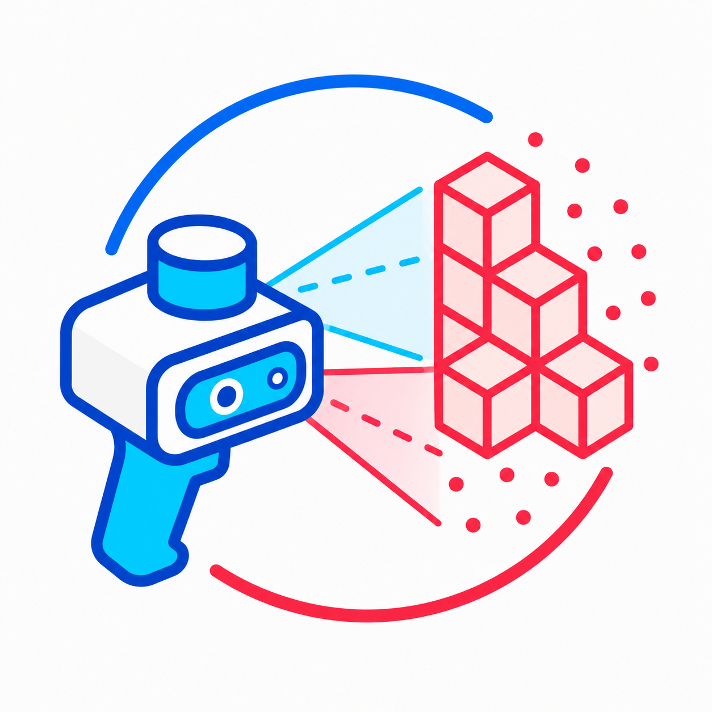
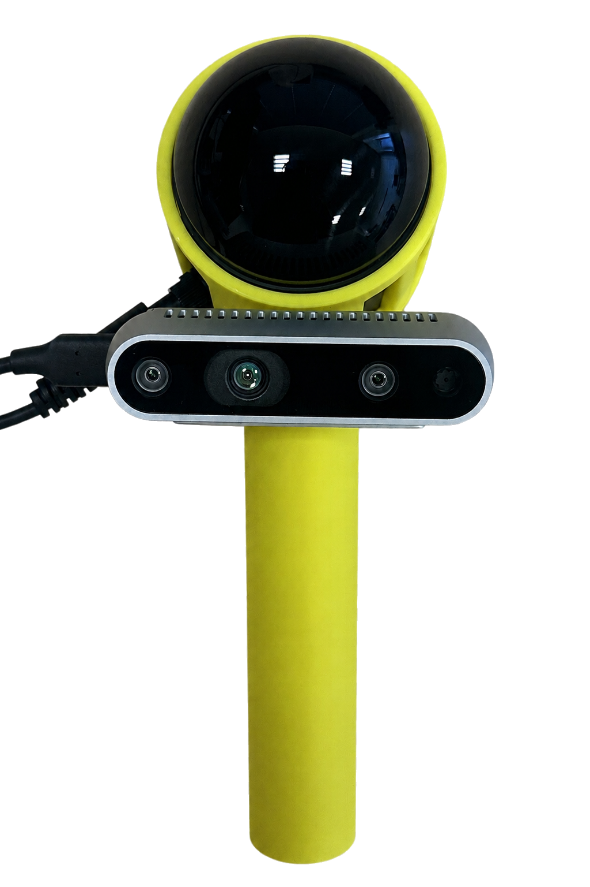
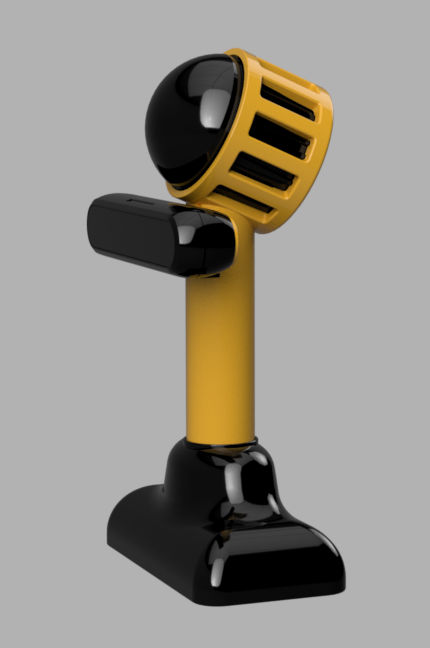
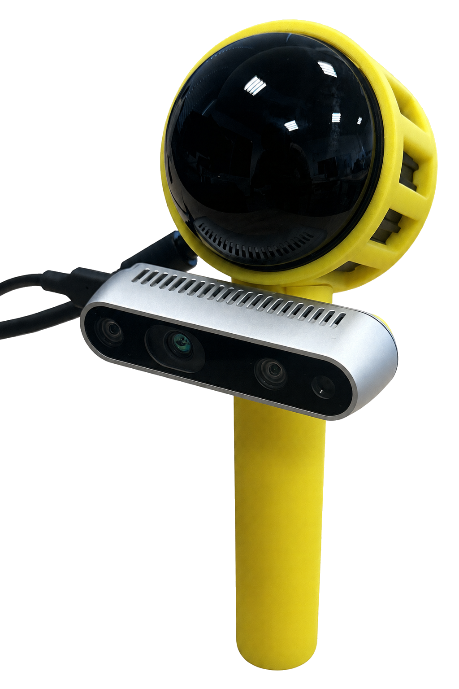
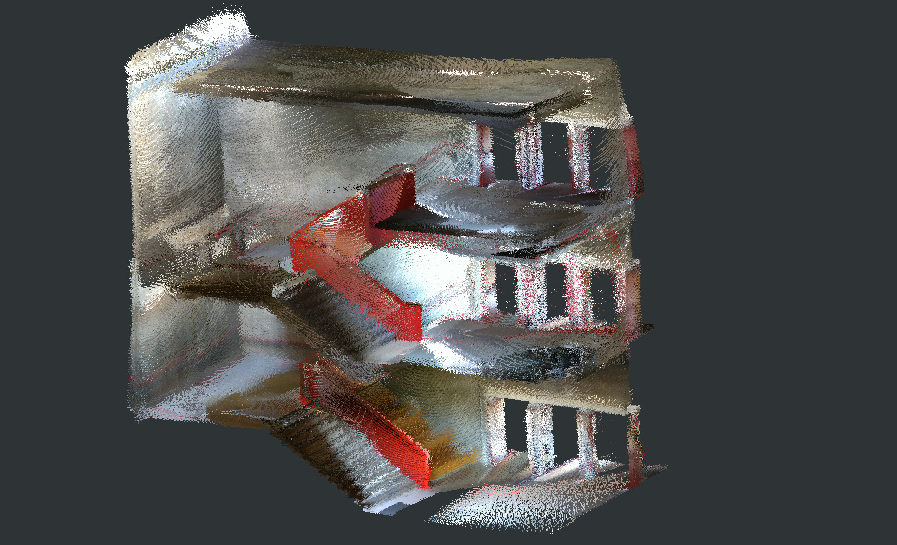
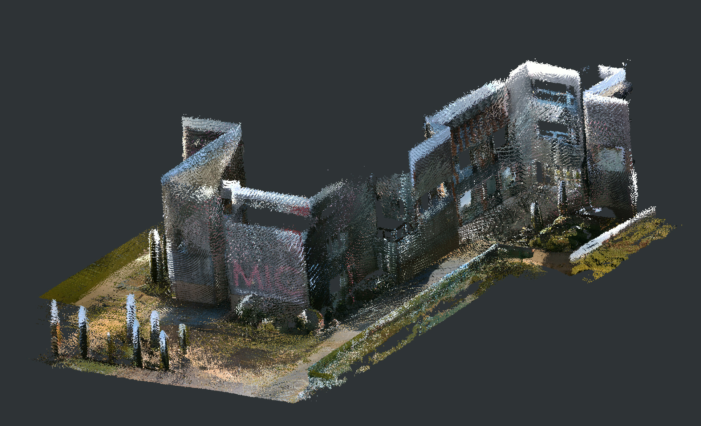

# Low-Cost Open-Source 3D LiDAR Scanner

<p align="center">
  
</p>

> Open and modular handheld system for 3D environment reconstruction using a 3D LiDAR, an RGB camera, 3D-printed components, and ROS 2.

<p align="center">
  

  
  
</p>

## Overview

This repository contains the hardware designs, ROS 2 software, and usage instructions for a low-cost handheld 3D scanning system.

The device combines:
- A **RoboSense Airy** 3D LiDAR.
- An **Intel RealSense D435i** RGB-D camera, currently used as an RGB camera.
- A rigid, lightweight, **3D-printed sensor mount**.
- An **NVIDIA Jetson AGX Orin** for data acquisition and processing.
- An external battery.

The system is designed for research, prototyping, and experimentation in 3D environment reconstruction, so use of different sensors is easy thanks to the modular design.

The system captures LiDAR point clouds and RGB images, estimates the sensor trajectory using LiDAR odometry/SLAM, and projects image information onto the point cloud to generate colorized 3D reconstructions.

## Main features

- Handheld and portable acquisition system.
- Open and modular hardware design.
- ROS 2-based software architecture.
- Synchronized LiDAR and RGB acquisition.
- LiDAR-camera extrinsic calibration.
- RGB point-cloud colorization.
- LiDAR odometry and 3D mapping.
- 3D-printable mechanical components.
- Support for recording datasets with ROS 2 bags.
- Designed for research, prototyping, and experimentation.

## Hardware

### Main components

| Component | Model | Purpose |
|---|---|---|
| 3D LiDAR | RoboSense Airy, 192 channels | Geometric acquisition and LiDAR odometry |
| RGB-D camera | Intel RealSense D435i | RGB image acquisition |
| Computing unit | NVIDIA Jetson AGX Orin | Sensor drivers and online processing |
| Mechanical structure | Custom 3D-printed mount | Rigid LiDAR-camera installation |
| Power supply | External battery | Portable operation |


## Repository structure

```text
.
├── config/                 # Calibration and runtime configuration files
├── docs/
│   └── images/             # README images
├── launch/                 # ROS 2 launch files
├── mechanical/             # STL files for 3D-printable components
├── src/                    # ROS 2 node for pointcloud colorizer
├── LICENSE
└── README.md
```

## Software requirements and environment setup

This packages contains the code needed to run the camera and LiDAR nodes and compute the colorized point cloud from both sensors data.
However, calibration and odometry/SLAM are handled by external packages, which must be installed separately.

### Calibration
Please, check https://github.com/koide3/direct_visual_lc for more information about markerless LiDAR-camera calibration.

### LiDAR odometry/SLAM
Please, check https://github.com/PRBonn/kiss-slam for more information about LiDAR odometry and SLAM.

### Prerequesites
Please install ROS 2 packages for Robosense Airy and Intel RealSense D435i.
- https://github.com/RoboSense-LiDAR/rs_driver
- https://github.com/realsenseai/librealsense


## Usage

### 1. Install ROS 2 Jazzy and prerequisites

### 2. Clone this repository, compile it and source your workspace

```bash
cd ~/ros2_ws/src
git clone https://github.com/martin-bayon/Open3DScanner
cd ~/ros2_ws
colcon build --symlink-install
source install/setup.bash
```

### 3. Perform LiDAR-camera calibration

Please, check https://github.com/koide3/direct_visual_lc for details.
Save the resulting extrinsic transformation in `config/calib.json`.

### 4. Run the project

A convinient ros2 launch file has been provided to run the complete pipeline, including sensor drivers and colorization of the point cloud.

Run:
```bash
ros2 launch open_3d_scanner full.launch.py 
```

This will start the LiDAR and camera drivers, and colorize the point cloud which can be examined on RViz.


## Example results

<p align="center">
  
  
</p>

The current prototype has been tested in indoor and outdoor environments. The preliminary results show that synchronized LiDAR and RGB acquisition can be used to produce visually enriched 3D point clouds and complete environment reconstructions.

## Citation

If you use this work, please consider citing our paper:

> Bayón-Gutiérrez, M., Gómez-Pascual, A., Fernández-Blanco, S.,
> Benítez Andrades, J.A. Benavides, C., Prieto-Fernández, N. 2026.
> Low-cost open-source system for 3D environment reconstruction.
> Jornadas de Automática, 47.

- DOI: `Pending`

### Citation

```bibtex
@inproceedings{bayon2026jjaa,
  author    = {Bayón-Gutiérrez, Martín and
               Gómez-Pascual, Alicia and
               Fernández-Blanco, Sergio and
               Benítez-Andrades, José Alberto and
               Benavides, Carmen and
               Prieto-Fernández, Natalia},
  title     = {Low-cost open-source system for 3D environment reconstruction},
  booktitle = {Jornadas de Automática},
  volume    = {47},
  year      = {2026},
  doi       = {pending}
}
```